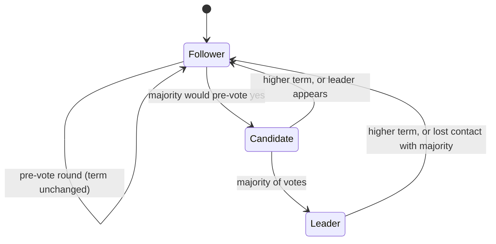

# Raft in goqueue: a study guide

This guide explains how the Raft implementation in `internal/raft/` works, for
someone who understands a simple job queue but is new to consensus. Read it
top to bottom once, then use it as a map: every section says which function
implements the idea and which test would fail if the idea were broken.

The reference is the Raft paper (Ongaro and Ousterhout, *In Search of an
Understandable Consensus Algorithm*, 2014). Its **Figure 2** is the spec; this
code follows it closely. Where it goes beyond the paper (PreVote, CheckQuorum,
leader stickiness, ReadIndex) that is called out.

## 0. The problem Raft solves

A single queue server is simple, and it is a single point of failure. To
survive a crash you need several copies. The hard part is keeping the copies
identical when machines crash, messages are lost or reordered, and the network
splits.

Raft solves this with **replicated state machine**:

```
   client ──► leader ──► [ log: cmd1 cmd2 cmd3 ... ] ──► every node applies the
                              replicated to followers      log in the same order
                                                                   │
                                                                   ▼
                                                          identical state machine
                                                          (here: the job queue)
```

If every node starts from the same state and applies the same commands in the
same order, every node ends in the same state. So the whole problem reduces to
**agreeing on the order of the log**. That is what Raft does. Rule one for the
state machine: it must be *deterministic* (no clock, no randomness inside
`Apply`), which is why goqueue puts timestamps inside each command.

Safety properties Raft guarantees (the paper calls them Figure 3):

| Property | Meaning |
|---|---|
| Election Safety | at most one leader per term |
| Leader Append-Only | a leader never overwrites or deletes its own log entries |
| Log Matching | if two logs have an entry with the same index and term, the logs are identical up to there |
| Leader Completeness | a committed entry is present in the log of every later leader |
| State Machine Safety | no two nodes ever apply different commands at the same index |

The test harness checks **Election Safety** and **State Machine Safety**
continuously, in every test (see section 13).

## 1. Map of the code

| File | What is in it |
|---|---|
| `types.go` | The public contract: `LogEntry`, `Config`, `Storage`, `Transport`, RPC structs, `Status`. |
| `node.go` | The `Node`: event loop, elections, replication, ReadIndex, handlers for inbound RPCs. |
| `apply.go` | The apply goroutine: feeds committed entries to the state machine, takes snapshots. |
| `rpc.go` | `RPCHandler`, the interface network layers call to deliver inbound RPCs. |
| `storage_mem.go` | `MemStorage` (tests, simulated crashes). |
| `storage_file.go` | `FileStorage`: WAL with CRC32, atomic hardstate and snapshot files. |
| `memnet/` | In-memory fault-injecting network for tests. |
| `httptransport/` | HTTP/JSON transport for real deployments. |
| `*_test.go` | The cluster test harness and the Raft scenario tests. |

## 2. The concurrency design: one goroutine owns the state

Most Raft bugs are concurrency bugs: two handlers touching `currentTerm` at
once, a lock held across an RPC. This implementation avoids the whole class of
problems with an **event loop** (`Node.run` in `node.go`):

```
  Handle* RPCs ──┐
  Propose ───────┤
  ReadIndex ─────┼──►  ┌──────────────────────┐        outbound RPCs run in their
  RPC responses ─┤     │  event loop goroutine │ ──go──► own goroutines and post
  ticker ────────┘     │  owns ALL mutable     │        their answer back as a
                       │  Raft state           │◄────── message on a channel
                       └──────────┬────────────┘
                                  │ committed entries (queue)
                                  ▼
                       ┌──────────────────────┐
                       │ apply goroutine       │  calls StateMachine.Apply,
                       │ (apply.go)            │  Snapshot, Restore
                       └──────────────────────┘
```

* One goroutine reads the channels in a `select` and mutates term, vote, role,
  log, `nextIndex`, `matchIndex`, `commitIndex`. No locks are needed for that
  state.
* The loop never waits on the network. `sendAppend` and `sendVote` start a
  goroutine per RPC; the reply comes back through `respC`.
* The loop *does* wait on disk (an fsync), by design: the rule "persist
  before replying" is easiest to get right when it is just sequential code.
* A slow state machine cannot delay heartbeats because `Apply` runs on the
  separate apply goroutine, fed by a queue (`queueApply`, `pushApply`).
* The few mutexes that exist guard data shared between goroutines and are
  listed at the top of `node.go`.

## 3. Terms and roles

Time is divided into **terms**, numbered 1, 2, 3, ... Each term has at most one
leader. A term is Raft's logical clock: a message from a lower term is stale and
is rejected; seeing a higher term makes a node adopt it and become a follower
immediately (`becomeFollower`).



Persistent state (must survive a restart): `currentTerm`, `votedFor`, the log.
In code: `Node.term`, `Node.votedFor`, `Node.log`, saved through `Storage`.

## 4. Leader election

**Idea.** A follower that hears nothing from a leader for a randomized timeout
assumes the leader is dead and campaigns. Randomization (`resetElectionTimer`,
timeout in `[ElectionTimeoutMin, ElectionTimeoutMax)`) makes it unlikely that two
nodes campaign at the same instant, which would split the vote.

**Steps** (`startElection`, `onRequestVote`, `onVoteResp`, `becomeLeader`):

1. Increment term, vote for yourself, **persist**, send `RequestVote` to all.
2. A node grants its vote if (a) the candidate's term is current, (b) it has not
   voted for someone else this term, and (c) the candidate's log is at least as
   up to date as its own (`logUpToDate`: compare last term, then last index).
   The vote is **persisted before the reply** (`flushHS`).
3. A majority of votes makes you leader (`becomeLeader`).

Why (b) gives Election Safety: each node votes once per term, and a majority
is needed, and two majorities always overlap in at least one node.
Why (c) gives Leader Completeness: a committed entry is on a majority, any
winning candidate needs votes from a majority, so at least one voter has the
committed entry and would refuse a candidate missing it.

Tests: `TestInitialElection`, `TestReElection`, `TestNoLeaderWithoutQuorum`.

### 4.1 PreVote (beyond the paper's Figure 2)

*Problem.* A node cut off from the cluster keeps timing out and incrementing its
term. When it reconnects, its huge term forces the healthy leader to step down,
for no reason.

*Fix.* Before a real election, a node asks "would you vote for me at term+1?"
**without changing anything** (`startPreVote`). Only if a majority says yes does
it increment its term. An isolated node never gets a majority, so its term never
moves.

```
isolated node:   pre-vote(term 6) ──✗ no reply ──► still term 5, try again later
reconnects:      leader's heartbeat (term 5) ──► it simply follows
```

*Stickiness.* A node also refuses pre-votes and votes while it has heard from a
current leader within `ElectionTimeoutMin` (`hasLeaderContact`), so a node that
merely has a flaky link cannot talk the cluster into an election.

Test: `TestPreVoteNoTermInflation` (an isolated node's term stays put and the
leader does not change on rejoin); `TestNoLeaderWithoutQuorum` also asserts the
minority side does not inflate terms.

### 4.2 CheckQuorum

A leader that cannot reach a majority steps down after `ElectionTimeoutMax`
(`checkQuorum`). Without it a partitioned old leader believes it is the leader
forever. It matters for client behavior (`Propose` fails with `ErrLeadershipLost`
instead of hanging) and for ReadIndex (section 9).

Tests: `TestProposeLeadershipLost`, `TestReadIndexDeposedLeader`.

## 5. Log replication

The leader appends client commands to its log and sends them to followers with
`AppendEntries`. The leader keeps, per follower:

* `nextIndex[p]`: the next entry to send.
* `matchIndex[p]`: the highest entry known to be stored on `p`.

Every `AppendEntries` carries `prevLogIndex` and `prevLogTerm`: the entry just
before the new ones. The follower accepts only if it has that exact entry. This
**consistency check** is what produces Log Matching by induction: an accepted
append proves the two logs agree at `prevLogIndex`, and (by induction) before it.

```
leader log:   [1:t1][2:t1][3:t2][4:t2][5:t3]
follower log: [1:t1][2:t1][3:t2][4:t2'][..]   <- conflicts at 4
leader sends prev=(3,t2) + entry 4  ->  follower: prev matches, entry 4 has a
different term, so DELETE entry 4 and everything after, then append.
```

In code: `sendAppend` (build the request, copy a batch of up to
`MaxEntriesPerAppend` entries), `onAppendEntries` (follower side: consistency
check, truncate conflicts, append, advance commit), `onAppendResp` (leader side).
A delayed duplicate `AppendEntries` must not truncate a longer log, so the
follower only truncates at an entry whose term actually differs.

Heartbeats are just empty `AppendEntries`, sent every `HeartbeatInterval`
(`tick`). `Propose` also triggers an immediate send (`handleProposals` calls
`broadcastAppend`) so latency is not tied to the heartbeat period.

Tests: `TestBasicAgree`, `TestFailAgree`, `TestConcurrentProposals`,
`TestRejoin`.

### 5.1 Fast backtracking

When the check fails the leader must find where the logs diverge. The naive way
decrements `nextIndex` by one per round trip, which is slow when a follower
has hundreds of divergent entries. Instead the follower returns hints
(`AppendEntriesResponse.ConflictTerm` and `ConflictIndex`):

```
follower: "my entry at prevLogIndex has term 4, and term 4 starts at index 31"
leader (backtrack): "do I have term 4?"
     yes -> nextIndex = my last index of term 4, + 1
     no  -> nextIndex = 31   (skip the whole term in one step)
```

If the follower's log is simply too short, it returns `ConflictTerm = 0` and
`ConflictIndex = lastIndex + 1`. Code: the follower side is in `onAppendEntries`
(the `ConflictTerm` block), the leader side is `backtrack`.

Test: `TestBackup` builds three conflicting 60-entry tails across leaders and
asserts the number of rejected `AppendEntries` during recovery stays small (a
one-step-at-a-time backoff would need about 60 per follower).

## 6. The commit rule and Figure 8

An entry is **committed** once the leader knows it is stored on a majority. A
committed entry is guaranteed never to be lost or changed. The leader tracks
`commitIndex` and tells followers via `leaderCommit` in later appends.

The subtle part is **Figure 8** of the paper. A leader must *not* count replicas
to commit an entry from an *earlier term*, even if a majority has it:

```
S1: [1][2]            S1 is leader in term 2, replicates entry 2 to S2 only, crashes.
S2: [1][2]            S5 wins term 3 (votes from S3,S4,S5), writes its own entry 3 at index 2.
S5: [1][3]            S1 comes back as leader in term 4 and re-replicates entry 2 (term 2)
                      to S3: now a majority (S1,S2,S3) has it.
                      If S1 called it committed and then crashed, S5 could still win
                      (its last term 3 > 2) and OVERWRITE index 2. A "committed"
                      entry would vanish.
```

*The rule:* the leader only advances `commitIndex` by counting replicas for an
entry **of its own current term** (`advanceCommit` checks `termAt(q) == n.term`).
Older entries become committed indirectly, because committing a newer entry
commits everything before it (Log Matching).

*The no-op.* A fresh leader may have nothing new to write, so older entries could
wait forever. Therefore every new leader appends a **no-op entry** of its own term
immediately (`becomeLeader`). Committing it commits the backlog. No-ops are never
passed to `StateMachine.Apply` (`applyEntries` skips `EntryNoop`).

Tests: `TestFigure8Unreliable` (random drops, delays and leader crashes while
proposing, then checks convergence), `TestRejoin`, `TestPersistenceRestartAll`.

## 7. Persistence and why fsync matters

Raft's promises hold only if some state survives crashes:

| State | Why it must be durable |
|---|---|
| `currentTerm`, `votedFor` | Forget your vote and you may vote twice in a term: two leaders. |
| Log entries | An entry acknowledged to the leader counts toward a majority. Lose it after acking and a "committed" entry can disappear. |
| Snapshot | Replaces the log prefix it covers. |

"Durable" means `fsync`, not just `write`: `write` only hands bytes to the OS
page cache. A power loss after `write` but before the OS flushes loses the data,
yet Raft already told the leader "got it". So:

* `flushHS` saves term/vote **before** any RPC reply or vote is sent.
* `Storage.Append` is durable **before** a follower replies success and before a
  leader counts its own copy.

`FileStorage` (`storage_file.go`):

```
dir/
  wal         [len u32][crc32 u32][index u64][term u64][type u8][data...]  x N, append-only
  hardstate   [crc32][json{term,voted_for}]   written to hardstate.tmp, fsync, rename
  snapshot    [crc32][json{last_index,last_term,data}]   same atomic replace
```

* The WAL write is a single `Write` plus `Sync` per `Append` call.
* Appending an index that already exists means "replace from here on": on load,
  a record with an index at or below the current end truncates the in-memory
  list first. There is no separate truncate record.
* **Torn writes.** A crash can leave half a record at the end. On load,
  `loadWAL` stops at the first record with a short header, impossible length,
  bad CRC, or an index gap, and truncates the file there. Everything before it
  is intact; the half-written append was never acknowledged, so dropping it is
  safe.
* Hardstate and snapshot use the temp-file/fsync/rename pattern so a reader
  sees the old version or the new one, never a mix. A corrupt one is a hard error
  (silently starting with term 0 could cause double voting).
* Compaction after a snapshot rewrites the WAL without the prefix. A crash
  between "snapshot file written" and "WAL rewritten" is handled: load skips WAL
  records already covered by the snapshot.

Tests: `storage_test.go` (table tests, `TestFileStorageCorruption` flips bytes,
tears and extends the WAL, `TestFileStorageCrashDuringCompaction`);
`TestPersistenceRestartAll` (whole cluster restarts on its storage);
`TestSingleNode`.

## 8. Snapshots and InstallSnapshot

Without compaction the log grows forever and a restarted node replays all of it.
When `lastApplied - lastSnapshotIndex >= SnapshotThreshold`, the **apply
goroutine** (`maybeSnapshot`):

1. calls `sm.Snapshot()` (safe: no `Apply` runs at the same moment),
2. saves `Snapshot{LastIndex, LastTerm, Data}` to `Storage`, which drops the log
   prefix,
3. tells the event loop (`snapC`) which trims its in-memory log (`handleSnapDone`).

Restart: `NewNode` loads the snapshot, calls `sm.Restore`, then the remaining log
entries are re-applied once the node learns they are committed.

A follower that is so far behind that the leader already discarded the entries it
needs cannot be fed by `AppendEntries`. When `nextIndex[p] <= snapshotIndex`, the
leader sends the snapshot itself (`sendSnapshot`; one RPC, no chunking). The
follower (`onInstallSnapshot`) saves it, keeps any log suffix that agrees with
the snapshot, discards the rest, and has the apply goroutine `Restore` it.

Tests: `TestSnapshotInstall` (lagging follower catches up and at least one
`InstallSnapshot` RPC was used), `TestSnapshotRestart` (restart from snapshot plus
replay, exact applied sequence, no duplicates).

## 9. Linearizable reads: ReadIndex vs lease reads

Reading from the leader's local state machine is fast, but is it safe? A leader
that was just deposed (partitioned away, a new leader elected) may not know it
and could return stale data. Two fixes:

**ReadIndex** (implemented; thesis section 6.4). To serve a read the leader:

1. makes sure it has committed an entry of its **current term** (the no-op), so
   its `commitIndex` is up to date (`noopIndex` check in `checkReads`),
2. records `readIndex = commitIndex`,
3. confirms it is still leader by getting a heartbeat acknowledged by a
   majority **sent after the read arrived** (`handleRead` bumps `readEpoch`; each
   outbound `AppendEntries` carries the epoch it was sent in and `ackEpoch`
   tracks the latest epoch each follower acknowledged),
4. waits until `lastApplied >= readIndex` (`waitApplied`), then reads locally.

Cost: one round of heartbeats per read (batched: reads arriving together share
one round), no log write.

**Lease reads** (not implemented). The leader assumes that for a fixed time
after a majority heartbeat nobody else can be elected (because followers will
not vote for that long) and serves reads locally with no round trip. Faster, but
it relies on bounded clock drift between machines; if clocks misbehave you get
stale reads. goqueue prefers the choice that needs no timing assumptions for
correctness. (Stickiness and CheckQuorum above use time, but only for liveness,
never for safety.)

Tests: `TestReadIndexDeposedLeader` (healthy leader succeeds; a follower returns
`ErrNotLeader`; a partitioned leader's ReadIndex never succeeds; the new leader's
read sees the newest committed write).

## 10. Proposals: from `Propose` to a result

```
Propose(data) ──► event loop: append to log (durable) ──► register waiter[index, term]
                                  │
                      replicate ──┘   majority matches ─► commitIndex advances
                                                                │
                      apply goroutine: Apply(entry) ──► result ─┘──► waiter ──► Propose returns
```

* On a non-leader: `ErrNotLeader` immediately (an atomic flag, no queueing).
* The waiter is keyed by index **and term**. If the entry committed at that index
  has a different term, our proposal was overwritten by a newer leader:
  `ErrLeadershipLost` (`resolveWaiter`).
* If the node steps down with proposals still uncommitted, they fail with
  `ErrLeadershipLost` (`failLeaderState`). The outcome is genuinely unknown (the
  entry may still commit under the next leader). Callers that need exactly-once
  effects must use idempotency keys, which goqueue's `Enqueue` does.
* `Stop` makes every waiter return `ErrStopped`.

Tests: `TestProposeOnFollower`, `TestProposeLeadershipLost`,
`TestStopUnblocksWaiters`, `TestConcurrentProposals`.

## 11. Transports

`Transport` is the outbound side (`RequestVote`, `AppendEntries`,
`InstallSnapshot`); inbound RPCs call the `Node.Handle*` methods (the `RPCHandler`
interface).

* `memnet`: in-process; supports `Disconnect`, `Partition`, drop rate, random
  delay (which reorders messages), and checks reachability again when the
  response travels back, so a partition that appears mid-RPC takes effect.
* `httptransport`: `POST /raft/vote|append|snapshot` with JSON, keep-alive via a
  shared `http.Client`. Test: `TestThreeNodeClusterOverHTTP`.

## 12. Configuration knobs

| Field | Meaning | Rule of thumb |
|---|---|---|
| `HeartbeatInterval` | leader heartbeat period | << election timeout (about 1/3 or less) |
| `ElectionTimeoutMin/Max` | follower timeout range | at least 10x network round trip; the spread avoids split votes |
| `MaxEntriesPerAppend` | batch size | larger = fewer RPCs, bigger messages |
| `SnapshotThreshold` | applied entries between snapshots | trade replay time against snapshot cost |

Liveness (a leader is eventually elected) needs
`broadcastTime << electionTimeout << MTBF`. Safety never depends on timing.

## 13. How the tests check safety

`harness_test.go` builds a cluster of N real nodes on `memnet`. A background
goroutine runs during **every** test:

* **Election Safety:** it polls every node's `Status()` and records
  `term -> leader`; two different leaders for one term fails the test.
* **State Machine Safety:** each node's state machine records `(index, value)`
  for every applied command; every few milliseconds the harness checks that every
  node's sequence is a prefix of the longest one.

Scenario tests then use helpers modeled on the MIT 6.5840 labs (`checkOneLeader`,
`checkNoLeader`, `one`, `nCommitted`, `crash`, `restart`).

| Test | Mechanism it protects |
|---|---|
| `TestInitialElection`, `TestReElection` | election, step-down, stable leadership |
| `TestNoLeaderWithoutQuorum` | quorum requirement, PreVote, CheckQuorum |
| `TestBasicAgree`, `TestFailAgree`, `TestFailNoAgree` | replication, commit needs a majority |
| `TestConcurrentProposals` | batching, distinct indexes, result delivery |
| `TestRejoin` | uncommitted entries of a deposed leader are discarded |
| `TestBackup` | fast backtracking |
| `TestPersistenceRestartAll` | durable term, vote, log |
| `TestFigure8Unreliable` | commit rule under drops, delays and crashes |
| `TestSnapshotInstall`, `TestSnapshotRestart` | snapshots, InstallSnapshot, replay |
| `TestReadIndexDeposedLeader` | ReadIndex |
| `TestPreVoteNoTermInflation` | PreVote |
| `storage_test.go` | WAL format, atomic files, corruption recovery |

Run them:

```
go test -race -count=1 ./internal/raft/...
go test -run Figure8 -count=20 ./internal/raft/       # hammer one scenario
go test -bench Propose3Nodes -run '^$' ./internal/raft/
```

## 14. Known limitations

* The cluster membership is static (no joint consensus).
* `InstallSnapshot` sends the whole snapshot in one RPC.
* No pipelining of `AppendEntries`: one is in flight per follower at a time
  (batching compensates).
* Lease reads are not implemented (see section 9).
* The log is kept fully in memory in addition to the WAL.
